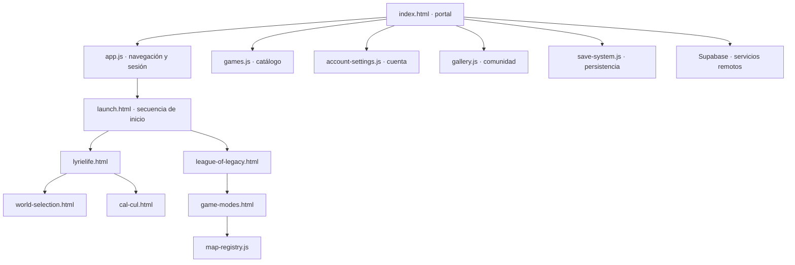

# Arquitectura del proyecto — STARSHIP UNIVERSE LEAGUE

**Revisión:** 17 de noviembre de 2026  
**Rama principal:** `main`

## Propósito

STARSHIP UNIVERSE LEAGUE es el punto de entrada común para experiencias distintas. El sitio comparte navegación, cuenta y servicios comunes, pero conserva separados los recursos, la interfaz y la lógica propia de cada juego.

## Mapa de componentes

## Estructura principal

- `index.html`: portal y punto de entrada.
- `launch.html`: secuencia de apertura y carga del juego elegido.
- `app.js`: navegación e integración de pantallas.
- `games.js`: catálogo de experiencias.
- `account-settings.js`, `entitlements.js`: cuenta y permisos.
- `gallery.js`: galería y funciones sociales.
- `save-system.js`: operaciones de guardado.
- `supabase-config.js`: configuración pública del cliente Supabase.
- `styles.css`, `public-landing.css`, `private-home.css`: estilos globales y de vistas.
- `docs/`: especificaciones, auditorías, logística y fuentes de diseño.
- `scripts/repo_audit.py`: auditoría estática y comprobación remota opcional.
- `.github/workflows/repo-audit.yml`: ejecución automática de la auditoría.

## Límites entre juegos

### The LyrieLife

La experiencia de The LyrieLife vive en `lyrielife.html`. Su selección de mundos está en `world-selection.html`; CAL/CUL se conserva como módulo separado en `cal-cul.html` y sus recursos fuente se organizan bajo `assets/The-LyrieLife/CAL-CUL/`.

Los mundos fuente permanecen bajo `assets/The-LyrieLife/Worlds/` en sus formatos originales. La presencia de un archivo `.world` no significa que el motor web ya pueda importarlo: el importador y la validación de cada formato siguen siendo tareas independientes.

### League Of Legacy

La experiencia vive en `league-of-legacy.html`. El flujo de modos se conecta con `game-modes.html`, y `map-registry.js` mantiene la asignación de modos, mapas y estado de autorización. Los ocho modelos de personaje permanecen en `assets/league-of-legacy/characters/`.

Los recursos de mapas conservan sus formatos de origen en `assets/league-of-legacy/Map/`. Un archivo presente no equivale a un mapa integrado, optimizado o listo para partidas.

## Recursos compartidos

- `assets/videos/UNIVERSE LEAGUE (Opening).mp4`: apertura compartida.
- `assets/videos/Lyrie Loanding.mp4`: vídeo de carga de The LyrieLife.
- `assets/videos/Loading LOL.mp4`: vídeo de carga de League Of Legacy.

Los recursos que sirven a ambos juegos deben permanecer en ubicaciones compartidas. Los recursos específicos se quedan dentro de la carpeta del juego correspondiente.

## Servicios y configuración

El portal carga la configuración de Supabase desde `supabase-config.js` y enlaza los módulos de cuenta, permisos, galería y guardado. Las credenciales privadas nunca deben añadirse al repositorio; las claves públicas deben limitarse mediante políticas y permisos del lado del servicio.

La auditoría remota de Supabase es opcional y requiere las variables/secrets descritos en el workflow. Si no están configurados, el paso remoto se omite; eso no certifica que Auth, tablas o Storage estén listos.

## Estado funcional y límites conocidos

- La navegación y los prototipos de interfaz están conectados.
- El visor de personajes de League Of Legacy carga GLB y muestra las animaciones incluidas en cada archivo.
- CAL/CUL está enlazado como módulo, pero no se debe asumir que todas las herramientas de creación o exportación estén terminadas.
- Los mundos de The LyrieLife aún necesitan un importador real para sus archivos fuente.
- Los mapas de League Of Legacy están sujetos a verificación técnica y de licencia. Los recursos con derechos no despejados deben seguir bloqueados.
- No se debe presentar el proyecto como un multijugador completo: matchmaking, servidor de partidas, sincronización de estado y reglas de combate requieren implementación y pruebas adicionales.

## Mantenimiento

1. Mantener los nombres y las mayúsculas de las rutas exactamente como están en Git.
2. Conservar los formatos fuente originales; generar derivados web en rutas separadas cuando haga falta.
3. Antes de mover un recurso, actualizar todas sus referencias y el inventario.
4. Ejecutar `python scripts/repo_audit.py` y revisar el workflow de GitHub Actions después de cada cambio estructural.
5. Actualizar `assets/ASSET_MANIFEST.md` al añadir, retirar o sustituir assets.

## Prototipos y referencias visuales — revisión 17 de noviembre de 2026

- `assets/The-LyrieLife/CAL-CUL/Create-A-Lyrie-preview.html`: vista previa independiente de Create A Lyrie. El módulo activo sigue siendo `cal-cul.html`.
- `assets/The-LyrieLife/UI/`: contiene la vista previa del HUD, sus notas y una referencia del menú principal. No se cargan automáticamente desde el lanzador.
- `assets/league-of-legacy/references/`: conserva una referencia visual del cliente de League of Legends. No es una pantalla activa de League Of Legacy ni debe tratarse como recurso autorizado para reutilización.
- Los recursos de Jaque Matte y Pinkie Star permanecen en sus carpetas separadas bajo `assets/`; su conexión con tarjetas, juegos y guardados se debe validar por separado.

Los prototipos y referencias se mantienen separados del código de producción hasta que se revisen, adapten a la identidad de cada juego y se conecten explícitamente.
