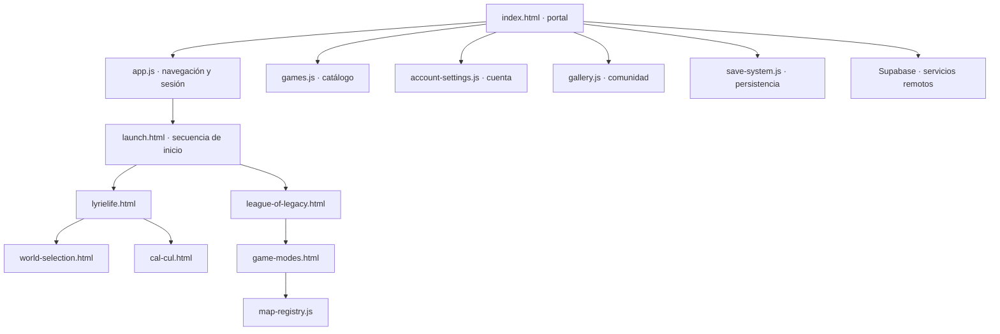

# Arquitectura del proyecto — STARSHIP UNIVERSE LEAGUE

**Revisión:** 17 de noviembre de 2026  
**Rama principal:** `main`

## Propósito

STARSHIP UNIVERSE LEAGUE es el punto de entrada común para experiencias distintas. El sitio comparte navegación, cuenta y servicios comunes, pero conserva separados los recursos, la interfaz y la lógica propia de cada juego.

## Mapa de componentes

## Estructura principal

- `index.html`: portal y punto de entrada.
- `launch.html`: secuencia de apertura y carga del juego elegido.
- `app.js`: navegación e integración de pantallas.
- `games.js`: catálogo de experiencias.
- `account-settings.js`, `entitlements.js`: cuenta y permisos.
- `gallery.js`: galería y funciones sociales.
- `save-system.js`: operaciones de guardado.
- `supabase-config.js`: configuración pública del cliente Supabase.
- `styles.css`, `public-landing.css`, `private-home.css`: estilos globales y de vistas.
- `docs/`: especificaciones, auditorías, logística y fuentes de diseño.
- `scripts/repo_audit.py`: auditoría estática y comprobación remota opcional.
- `.github/workflows/repo-audit.yml`: ejecución automática de la auditoría.

## Límites entre juegos

### The LyrieLife

La experiencia de The LyrieLife vive en `lyrielife.html`. Su selección de mundos está en `world-selection.html`; CAL/CUL se conserva como módulo separado en `cal-cul.html` y sus recursos fuente se organizan bajo `assets/The-LyrieLife/CAL-CUL/`.

Los mundos fuente permanecen bajo `assets/The-LyrieLife/Worlds/` en sus formatos originales. La presencia de un archivo `.world` no significa que el motor web ya pueda importarlo: el importador y la validación de cada formato siguen siendo tareas independientes.

### League Of Legacy

La experiencia vive en `league-of-legacy.html`. El flujo de modos se conecta con `game-modes.html`, y `map-registry.js` mantiene la asignación de modos, mapas y estado de autorización. Los ocho modelos de personaje permanecen en `assets/league-of-legacy/characters/`.

Los recursos de mapas conservan sus formatos de origen en `assets/league-of-legacy/Map/`. Un archivo presente no equivale a un mapa integrado, optimizado o listo para partidas.

## Experiencias adicionales

### Geffenite — Batalla Estelar

- Gameplay fuente: `assets/Geffenite/gameplay/Geffenite_ Batalla Estelar.html`.
- Dossier, requisitos VIP y mapa conceptual: `assets/Geffenite/docs/`.
- Identidad visual: `assets/Geffenite/images/`.
- La beta se ofrece desde el área VIP. El frontend espera una entitlement o plan compatible Young-Moon/Exoplanet devuelto por starship-entitlements; la comprobación real de vigencia debe confirmarse en esa función remota. Mantener el control de acceso tanto en la interfaz como en la lógica de permisos.
- El HTML del mapa Eco Sónico Cósmico es una referencia interactiva; no sustituye un sistema de mapas jugable.

### GellyShow

- Juego 2D autónomo: `assets/GellyShow/Gameplay/GellyShow.html`.
- Documentación: `assets/GellyShow/Docs/`.
- Imágenes: `assets/GellyShow/Images/`.
- La documentación indica que el modo Online requiere un servidor y aún no está disponible.
- El juego base está conectado al catálogo gratuito y al flujo de instalación/biblioteca; QA de navegador pendiente. El modo Online requiere servidor y aún no está disponible.

### Geffen: Monopoly

- Juego: `assets/geffen-monopoly/geffen_monopoly_juego_de_mesa_interactivo.html`.
- Especificación: `assets/geffen-monopoly/documentaci_n_del_sistema_geffen_monopoly.txt`.
- El portal lo ofrece como Gratis · Demo, con instalación simulada y lanzamiento desde Juegos instalados.
- El documento describe modos contra bots y Pass & Play local. No se afirma que tenga multijugador online.

### Club de Cartas — Solitario y Versus

- Juego: `assets/star-solitaire/club_de_cartas_solitario_y_versus.html`.
- El portal lo ofrece como Gratis · Demo, con instalación simulada y lanzamiento desde Juegos instalados.
- Incluye Solitario en Fila y Versus contra bot; no se ha verificado un servidor multijugador.

### Starship Plus — plataforma audiovisual

- Interfaz: `assets/starship-plus/starship-plus.html`.
- Especificación: `assets/starship-plus/starship-plus-funcionalidades.txt`.
- El acceso desde el portal está enlazado en el bloque de beneficios Starship Plus Pro para miembros.
- La versión actual es una demostración: catálogo de muestra, reproductor simulado y datos guardados en localStorage. No reproduce vídeos reales ni autentica perfiles contra un backend.
- La visibilidad del botón en el portal no protege el archivo estático frente a acceso directo. Cualquier estreno privado futuro requiere autorización real del servidor y medios privados.

Estos proyectos mantienen sus propios recursos y no se mezclan con The LyrieLife, CAL/CUL, League Of Legacy, Geffenite, GellyShow, Pinkie Star ni Jaque Matte.

## Recursos compartidos

- `assets/videos/UNIVERSE LEAGUE (Opening).mp4`: apertura compartida.
- `assets/videos/Lyrie Loanding.mp4`: vídeo de carga de The LyrieLife.
- `assets/videos/Loading LOL.mp4`: vídeo de carga de League Of Legacy.

Los recursos que sirven a ambos juegos deben permanecer en ubicaciones compartidas. Los recursos específicos se quedan dentro de la carpeta del juego correspondiente.

## Servicios y configuración

El portal carga la configuración de Supabase desde `supabase-config.js` y enlaza los módulos de cuenta, permisos, galería y guardado. Las credenciales privadas nunca deben añadirse al repositorio; las claves públicas deben limitarse mediante políticas y permisos del lado del servicio.

La auditoría remota de Supabase es opcional y requiere las variables/secrets descritos en el workflow. Si no están configurados, el paso remoto se omite; eso no certifica que Auth, tablas o Storage estén listos.

## Estado funcional y límites conocidos

- La navegación y los prototipos de interfaz están conectados.
- El visor de personajes de League Of Legacy carga GLB y muestra las animaciones incluidas en cada archivo.
- CAL/CUL está enlazado como módulo, pero no se debe asumir que todas las herramientas de creación o exportación estén terminadas.
- Los mundos de The LyrieLife aún necesitan un importador real para sus archivos fuente.
- Los mapas de League Of Legacy están sujetos a verificación técnica y de licencia. Los recursos con derechos no despejados deben seguir bloqueados.
- No se debe presentar el proyecto como un multijugador completo: matchmaking, servidor de partidas, sincronización de estado y reglas de combate requieren implementación y pruebas adicionales.

## Mantenimiento

1. Mantener los nombres y las mayúsculas de las rutas exactamente como están en Git.
2. Conservar los formatos fuente originales; generar derivados web en rutas separadas cuando haga falta.
3. Antes de mover un recurso, actualizar todas sus referencias y el inventario.
4. Ejecutar `python scripts/repo_audit.py` y revisar el workflow de GitHub Actions después de cada cambio estructural.
5. Actualizar `assets/ASSET_MANIFEST.md` al añadir, retirar o sustituir assets.

## Prototipos y referencias visuales — revisión 17 de noviembre de 2026

- `assets/The-LyrieLife/CAL-CUL/Create-A-Lyrie-preview.html`: vista previa independiente de Create A Lyrie. El módulo activo sigue siendo `cal-cul.html`.
- `assets/The-LyrieLife/UI/`: contiene la vista previa del HUD, sus notas y una referencia del menú principal. No se cargan automáticamente desde el lanzador.
- `assets/league-of-legacy/references/`: conserva una referencia visual del cliente de League of Legends. No es una pantalla activa de League Of Legacy ni debe tratarse como recurso autorizado para reutilización.
- Jaque Matte y Pinkie Star son minijuegos independientes para Astronautas. Pinkie Star es el Mahjong Solitaire antes rotulado provisionalmente como Pixxy Up. La interfaz mantiene `pixxy` como token interno de lanzamiento y los controles `pixxy-*`; las partidas nuevas usan la clave `pinkie-star` y migran la lectura de partidas anteriores `pixxy-up`. Sus imágenes permanecen en `assets/Pinkie-Star/Images/`; el icono está conectado al catálogo y el póster se conserva como recurso de referencia.

Los prototipos y referencias se mantienen separados del código de producción hasta que se revisen, adapten a la identidad de cada juego y se conecten explícitamente. `docs/DOCUMENTATION_INDEX.md` es el índice de navegación documental; los documentos originales `.txt` conservan sus nombres y rutas.

- Jaque Matte and Pinkie Star require the same account installation flow as paid games: catalog → install → installed library → play. GellyShow is listed as Gratis · Demo and launches from the installed library; Online remains server-dependent and unavailable. Geffenite remains behind its VIP entitlement gate and uses the same install/library path after access is verified.

## Universe Pay / Starship Plus member benefits (2026-11-17)

The header Universe Pay action opens the membership and benefits panel without requiring login to read it. Baby-Star, Young-Moon, and Exoplanet members are described as receiving Starship Plus early premieres before the official YouTube release and Starship Plus Pro access. Young-Moon and Exoplanet are VIP tiers with VIP game/beta access and a 50% discount on eligible purchases (illustrative example: US$10 → US$5). The early-premiere area is gated by the active membership/plan returned by `starship-entitlements`.

Payment processing and purchase checkout are not integrated, so the 50% discount is currently a displayed membership benefit, not an applied transaction price. No Starship Plus Pro destination URL or private premiere video links have been supplied; those integrations remain pending and the page shows a clear empty state rather than fabricated releases or destinations.
